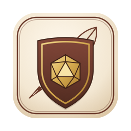
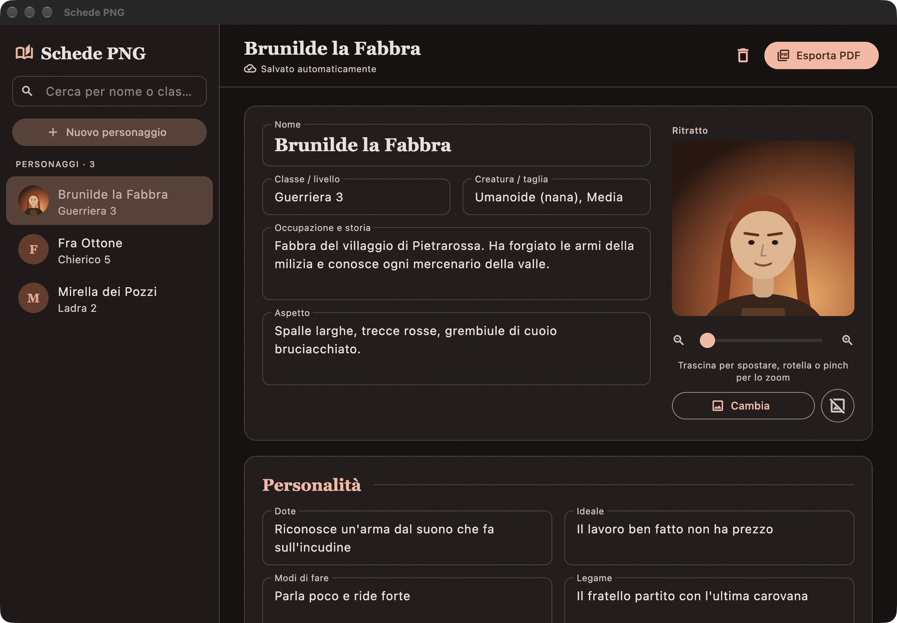

<p align="center">
  
</p>

<h1 align="center">Schede PNG</h1>

<p align="center">
  A desktop editor for non-player character sheets that exports a parchment-style, fillable PDF.<br>
  Built with <a href="https://flutter.dev">Flutter</a> for macOS and Windows; the PDF is drawn with the <a href="https://pub.dev/packages/pdf">pdf</a> package.
</p>

<p align="center">
  
</p>

## Features

- **Autosave**: every change is written to disk as you type, so there is no save button. A new sheet is stored as soon as any field has text or a portrait.
- **Character list**: the sidebar lists saved characters with a thumbnail, filters them by name or class (**Cerca per nome o classe**), and **Nuovo personaggio** starts a blank sheet (⌘N, Ctrl+N on Windows).
- **Portrait**: **Scegli immagine** loads a PNG, JPG, WebP, BMP or GIF. Drag to move it, and use the mouse wheel, a trackpad pinch or the slider to zoom from 1× to 6×. The crop is kept with the character.
- **Statistics**: the six ability scores show their modifier (14 → +2). For saving throws and skills, the ⊕ button inserts an entry such as `Percezione +` and leaves the cursor ready for the bonus.
- **PDF export**: **Esporta PDF** (⌘E, Ctrl+E on Windows) writes a two-page A4 sheet, *Scheda PNG* and *Capacità e azioni*. Filled fields are printed as text and empty ones stay fillable form fields, so exporting a blank sheet gives a printable or fillable template. **Apri** in the confirmation opens the file.
- **Delete**: the bin icon removes the character and its portrait after a confirmation.

## Requirements

- macOS 12 or later, or Windows 10 or later.
- [Flutter](https://docs.flutter.dev/get-started/install) 3.47 or later (Dart 3.13).
- To build for macOS: Xcode. To build for Windows: Visual Studio 2022 with the "Desktop development with C++" workload.
- The Georgia font, which ships with macOS and Windows: the PDF uses it so that it looks the same on both.

Dependencies are installed with `flutter pub get`:

- `pdf` draws the sheet and its form fields.
- `file_selector` shows the native dialogs for picking a portrait and saving the PDF.

## Installation

```bash
git clone https://github.com/giuliomaffei90/character-sheets.git
cd character-sheets
flutter pub get
flutter build macos
open "build/macos/Build/Products/Release/Schede PNG.app"
```

On Windows, run `flutter build windows` instead; the app is `build\windows\x64\runner\Release\schede_png.exe` and the whole `Release` folder is needed to run it.

There is no custom build script: `flutter build` compiles the app with the platform runners in `macos/` and `windows/`. Those runners were changed in three ways. The macOS App Sandbox is turned off in the entitlements, so the app can use `~/SchedePNG` and save PDFs anywhere. The window opens at 1180×820. On both systems it cannot be made smaller than 900×600.

For development, `flutter run -d macos` (or `-d windows`) starts the app with hot reload, and `flutter test` runs the checks in [test/app_test.dart](test/app_test.dart). The icon is drawn in [assets/icon.svg](assets/icon.svg). After editing it, regenerate the macOS and Windows icons with `swift assets/make_icons.swift`, which needs macOS 14 or later.

## How it works

1. At launch, [lib/main.dart](lib/main.dart) reads every `*.json` file in `~/SchedePNG` (`%USERPROFILE%\SchedePNG` on Windows) into the sidebar.
2. Each edit calls `save()`, which writes `<id>.json` with the fields, the portrait file name, the zoom and the crop centre. The id is 8 random hex digits. The format is the same as the earlier Python version's, so its characters open unchanged. Copying the folder moves the characters to another computer.
3. Picking a portrait copies the file into the same folder as `<id>.<extension>`. `region()` turns the zoom and crop centre into the visible rectangle of the image, keeping it inside the image's edges.
4. On export, `portraitPixels()` redraws that rectangle at 1000 px wide. [lib/sheet.dart](lib/sheet.dart) then draws the two pages, with frame, vines, banners, boxes, stat rings, shield and heart. For each field it either prints the wrapped text in Georgia or adds an empty PDF text field.
5. The bytes are written to the path chosen in the save dialog, with `.pdf` added if it is missing.

## Known limitations

- The interface is in Italian only.
- Text in the PDF is never shrunk: multi-line text that does not fit in its box is cut off, single-line fields can run past the box edge, and words longer than a line are not broken.
- Export fails with an error if the Georgia font is not installed.
- Thumbnails in the sidebar show the whole image centre-cropped, not the framing chosen for the sheet.
- There is no undo: autosave keeps every change, and deleting a character removes its files permanently.
- The Windows build has not been tested yet.
